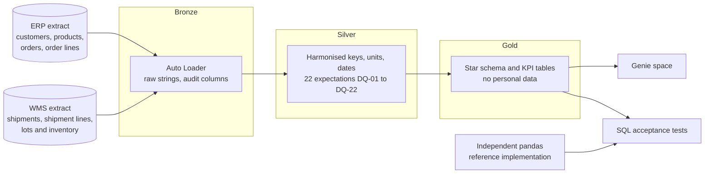
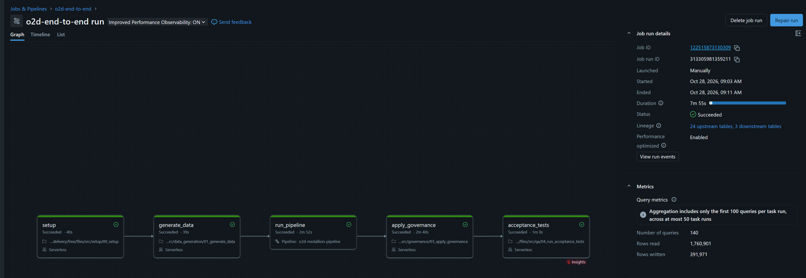
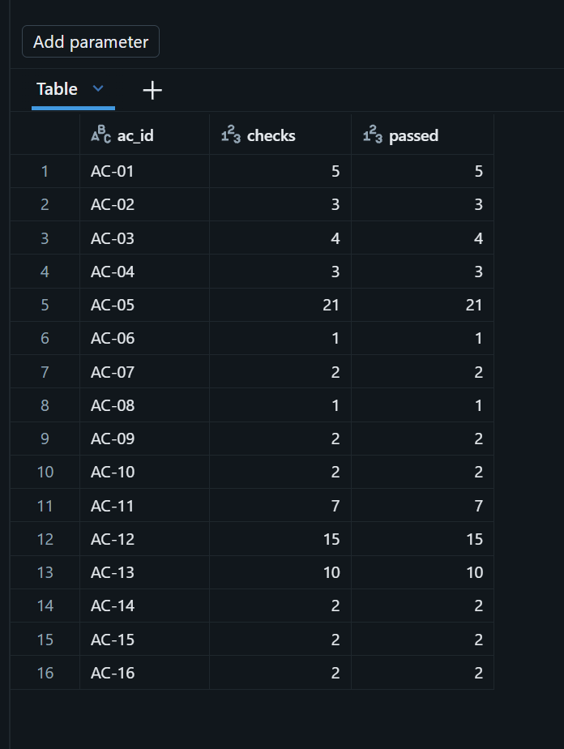
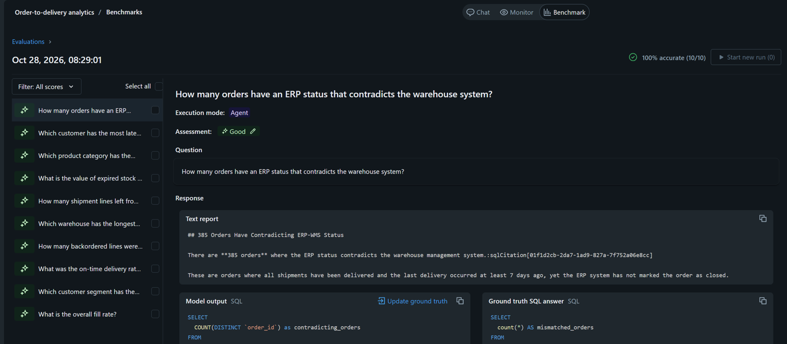

# Order-to-delivery analytics on Databricks


A governed medallion pipeline that answers one question for a distribution company: **are we delivering what customers ordered, when we promised it?**

The company is fictional (Laurentia Distribution: pharmacy, medical and hardware products, three warehouses) and all data is synthetic. The ERP and the warehouse system disagree on keys, units, date formats and order status, exactly as real systems do. The project reconciles them, publishes agreed KPIs, proves them with executable acceptance tests, and exposes them to business users through a Genie space.

It was built the way a functional analyst would deliver it: the specification, business rules and acceptance criteria were written first (`docs/`), then the pipeline, then the tests that prove each criterion.

## Why OTIF tells a different story than on-time delivery

| KPI (closed orders, 14,059 orders) | Result |
|---|---|
| Fill rate | 96.2% |
| On-time delivery (OTD) | 89.6% |
| In full | 78.7% |
| **OTIF** (on time and in full) | **60.8%** |
| Average order-to-delivery lead time | 2.37 days |
| Backordered lines | 3,386 (8,790 cases) |

On-time delivery looks healthy. OTIF does not: about one order in five has at least one short line (in full is 78.7%), and the two failures overlap only partly, so OTIF drops to 60.8%. Pharmacy customers have the worst OTIF (50.3%) (the generator makes pharmacy products ship short more often). Vancouver is the slowest warehouse (87.8% on time, 2.57 days). Beyond service levels, 123 shipment lines left from expired lots (a compliance finding) and $4.05 million of expired stock (5.8% of stock value) sits in the warehouses. 385 orders are still open in the ERP although the warehouse delivered them more than 7 days ago.

These figures come from the default seed and are reproduced by the acceptance tests, not typed in by hand.

## Architecture



Everything is a Lakeflow declarative pipeline (streaming tables for bronze, materialized views for silver and gold) on serverless compute, governed in Unity Catalog, and deployed as a Databricks Asset Bundle.

## What is in the repository

| Path | Content |
|---|---|
| `docs/01_functional_specification.md` | Purpose, personas, user stories, 17 acceptance criteria, traceability |
| `docs/02_business_rules.md` | 18 business rules (BR-01 to BR-18) and 22 data quality rules (DQ-01 to DQ-22) |
| `docs/03_source_to_target_mapping.md` | Column-level mapping from bronze to silver to gold |
| `docs/data_dictionary.csv` | Description and tags for every silver and gold table and column (drives governance) |
| `docs/04_run_on_databricks.md` | Step-by-step run guide |
| `src/data_generation/` | Deterministic synthetic data generator and the independent pandas reference |
| `src/pipelines/` | `bronze.sql`, `silver.sql`, `gold.sql` (the declarative pipeline) |
| `src/governance/` | Applies descriptions and tags in Unity Catalog from the data dictionary |
| `sql/tests/` | One SQL test file per acceptance criterion |
| `genie/` | Genie space setup and 10 benchmark questions with expected SQL |
| `tests/` | Local verification suite (DuckDB emulation of the pipeline) |
| `databricks.yml`, `resources/` | Asset Bundle: one pipeline and one job |

## Data model (gold)

Dimensions: `dim_date`, `dim_customer`, `dim_product`, `dim_warehouse`.
Facts: `fact_order` (order grain), `fact_order_line`, `fact_shipment_line`, `fact_inventory_lot`.
KPI tables: `kpi_order_performance` (month x segment x warehouse), `kpi_expired_lots`, `kpi_inventory_expiry`.
Data steward view: `dq_status_mismatch`.

KPI tables store numerators and denominators next to the ratios so they can be re-aggregated correctly at any level.

## Two systems that disagree

| Topic | ERP | WMS | Rule |
|---|---|---|---|
| Order number | `SO-100001` | `SO100001`, `so100001`, `SO100001 ` | BR-02 |
| Product | `SKU-00042` | `42`, `00042` | BR-02 |
| Warehouse | `WH-MTL` | `MTL` | BR-02 |
| Unit | cases | each (units) | BR-03 |
| Timestamps | ISO 8601 | `dd/MM/yyyy HH:mm` and sometimes `yyyy-MM-dd HH:mm` | BR-04 |
| Shipment lines | n/a | re-sent and corrected lines | BR-05 |
| Order status | lags behind reality | knows the deliveries | BR-16 |

## Data quality

Defects are injected on purpose, and the pipeline has to catch them. Counts below are for the default seed.

| Defect (injected) | Count | Handling |
|---|---|---|
| ERP orders without customer | 121 | DQ-06 rejects them, their lines follow (BR-17) |
| ERP orders without promised date | 140 | kept, flagged by DQ-09, excluded from OTD and OTIF (BR-08) |
| Order lines with zero or negative quantity | 205 | DQ-11 rejects them |
| Duplicate WMS shipment lines | 565 | deduplicated, latest version wins (BR-05) |
| Corrected WMS shipment lines (earlier wrong version) | 308 | deduplicated, latest version wins (BR-05) |
| WMS lines with negative quantity | 110 | DQ-17 rejects them |
| Shipments for orders unknown to the ERP | 60 | kept in silver, excluded from order KPIs, included in compliance KPIs (BR-17) |
| ERP orders that should be closed but are not | 389 | 385 listed in `gold.dq_status_mismatch` (the other 4 were already rejected for a missing customer) |
| Picks from expired lots (injected) | 56 | counted with the natural ones: 123 expired-lot shipment lines in total (BR-14) |
| Invalid customer emails | 10 | kept, flagged by DQ-02 |

## Acceptance tests

Each acceptance criterion has a SQL test in `sql/tests/`, for example AC-05: overall and per-month OTIF equal the reference values. The expected values come from `src/data_generation/reference.py`, an independent pandas implementation of the same rules that shares no code with the SQL. If the pipeline and the reference agree, it is real evidence.

Verification status:

| Where | Status |
|---|---|
| Local (DuckDB runs the exact pipeline SQL, 51 tests) | Passing. 11 deliberate breakages of the business logic (for example crediting over-shipments, dropping deduplication, an off-by-one on expiry) were each caught by at least one test. |
| Databricks Free Edition (job `o2d-end-to-end`, 5 tasks, serverless) | First run on 2026-10-28: pipeline, governance and tests ran. 81 of 82 checks passed, one governance check (AC-15) needed a fix. After the fix, a clean end-to-end run (all five tasks, 7 min 55 s) passed 82 of 82 checks. |
| Genie benchmark (AC-17, 10 questions) | First run 5 of 10 (the answers were right but ranking questions returned a top 10). After adding one instruction, 10 of 10. |

## Governance

- A catalog with one schema per layer (`bronze`, `silver`, `gold`) plus `qa`.
- Table descriptions are defined in the pipeline; column descriptions and tags come from `docs/data_dictionary.csv` and are applied by the job after each pipeline update.
- Customer email and phone are tagged `pii = true` in silver and never reach gold (AC-16). KPI columns carry a `kpi = true` tag.
- AC-15 checks in `information_schema` that every silver and gold table and column has a description.

## Genie

`genie/instructions.md` contains the space setup (tables, description, instructions, sample questions). `genie/benchmark.csv` holds 10 benchmark questions with expected SQL; the SQL is verified locally against the reference answers before it is used to grade Genie.

## Run it

Locally (no Databricks needed):

```
pip install -r requirements-dev.txt
pytest
```

On Databricks Free Edition (CLI authenticated with a personal access token). First create an empty catalog named `o2d` in the Catalog UI (Create catalog, standard, default storage), because Free Edition does not allow creating it from code:

```
databricks bundle validate
databricks bundle deploy
databricks bundle run o2d_end_to_end
```

The full guide is `docs/04_run_on_databricks.md`. If you prefer not to create a catalog, add `--var catalog=workspace` to the deploy and run commands to use the existing `workspace` catalog.

## Design decisions

- **Independent reference.** Tests compare the SQL against a separate pandas implementation, so a misreading of a rule in the SQL cannot also hide in the test.
- **Quantities compared in each.** Cases are for reporting only, because comparing fractional cases invites rounding errors.
- **Deterministic data.** One seeded generator using only the standard library gives identical files everywhere, so every number in this README is reproducible.
- **Ratios stored with numerators and denominators.** Averaging percentages is the classic KPI mistake, so the tables make it hard to do.
- **System of record per fact (BR-01).** When the ERP and WMS disagree, the owning system wins, and contradictions are surfaced (BR-16) rather than silently fixed.
- **Metadata re-applied after every refresh.** Pipeline-managed tables can lose metadata that is not part of their definition, so the job re-applies governance before running the checks that depend on it.

## Evidence from the Databricks run

The full job on Databricks Free Edition (serverless), all five tasks succeeded:



Acceptance checks by criterion (82 checks, all passing):



Genie benchmark, 10 of 10 after adding the ranking instruction:



## What the first real Databricks run taught me

The project was tested locally before it ever touched Databricks, and the first run still found three things that only a real workspace shows. I kept them in the repo because they are the honest story of the build.

1. **The catalog must exist before the pipeline is deployed.** A pipeline resource needs its catalog at deploy time, but my setup notebook created it later, at run time. On Free Edition, catalogs are also created in the UI (default storage), not by SQL or the CLI. The run guide now creates the catalog first.
2. **Databricks keeps hidden backing tables behind each materialized view.** They are named `__materialization_...` and appear in `information_schema`, so the "every column has a description" test (AC-15) counted 230 columns that are not part of the model. The test now excludes them. The 81 other checks, including every KPI, matched the independent reference on the first run.
3. **Genie answered correctly but in the wrong shape.** The first benchmark run scored 5 of 10. For example, "which customer has the most late orders" returned the right customer at the top of a top-10 list with extra columns. One instruction ("for which/most/lowest questions return exactly one row with only the name and the measure") brought the score to 10 of 10. Genie is an AI system, so the score can vary from run to run.

## Limitations

- The data is synthetic. Distributions were chosen to be plausible, not calibrated to a real company.
- The ERP closes an order 7 days after the last delivery (assumption). The status mismatch check cannot know about a backorder shipment the WMS has not planned yet.
- Local verification uses DuckDB. Platform behaviour (Auto Loader, Unity Catalog, materialized view refresh, Genie) is only exercised on Databricks.
- Free Edition limits apply: serverless compute only, one active pipeline per type, a single small SQL warehouse, and fair-use quotas.
